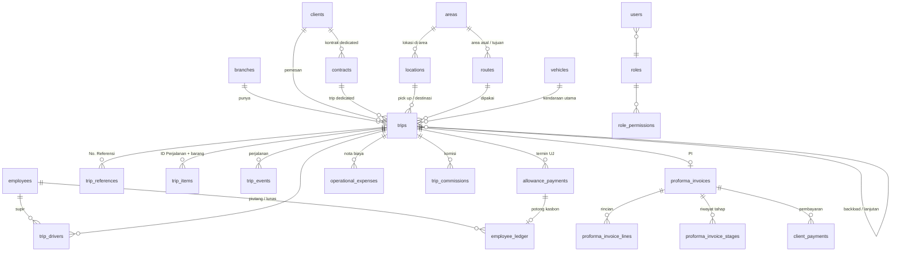

# Rancangan Database SIKOTIS

Usulan struktur data untuk tim backend (ASP.NET Core) — PT Bimajaya Mustika.
Versi 14 Oktober 2026. Acuan: prototipe React di `Perbaikan sementara` dan revisi atasan 13 Oktober 2026.

Frontend: **React + Bootstrap 5**. Backend: database + API (Swagger: `https://bjm-api.anomalistudio.com/swagger`).
Nama tabel & kolom ditulis dalam bahasa Inggris (lazim di database); keterangannya dalam bahasa Indonesia.
Tipe `id` di dokumen ini ditulis `uuid` — tipe pastinya disepakati dengan backend (lihat bagian 10).

---

## 1. Ringkasan

Database dibagi menjadi **enam kelompok**:

| Kelompok | Isi | Tabel utama |
|---|---|---|
| A. Pengaturan & Akses | Cabang, pengguna, peran, izin, catatan audit | `branches`, `users`, `roles`, `permissions`, `role_permissions`, `audit_logs`, `app_settings` |
| B. Master Data | Data acuan yang jarang berubah | `employees`, `vehicles`, `trailer_types`, `areas`, `locations`, `routes`, `clients`, `contracts`, `commission_rules`, `expense_types` |
| C. Operasional Trip | Satu perjalanan beserta isinya | `trips`, `trip_drivers`, `trip_references`, `trip_items`, `trip_events` |
| D. Keuangan | Semua uang yang keluar & masuk | `allowance_payments`, `operational_expenses`, `trip_commissions`, `internal_costs`, `employee_ledger`, `proforma_invoices`, `proforma_invoice_lines`, `proforma_invoice_stages`, `client_payments` |
| E. Dokumen & Lampiran | Berkas KTP/SIM/STNK/POD/nota dll. | `documents`, `attachments` |
| F. Khusus Priok | Container & SI/JO | `job_orders`, `priok_billings` |

Master data yang kamu sebut (Supir/Karyawan, Kendaraan, Rute, Klien, Pengaturan admin) masuk kelompok A dan B.
Ditambah **Lokasi / Alamat** (dipakai Rute dan Trip), **Jenis gandengan**, **Jenis biaya**, dan **Aturan komisi**.

---

## 2. Prinsip yang menjaga data keuangan tetap benar

1. **Uang disimpan sebagai bilangan bulat Rupiah** (`bigint`), tanpa desimal. Rp 1.250.000 disimpan `1250000`.
2. **Catatan keuangan tidak pernah dihapus permanen.** Trip, termin, nota, PI, dan piutang dibatalkan dengan alasan
   (status `cancelled` / entri koreksi), bukan `DELETE`. Hapus permanen hanya untuk data uji, oleh Owner.
3. **Nilai yang sudah dipakai dokumen dibekukan (snapshot).** Harga trip, alamat pick up/destinasi, nilai & rincian PI,
   dan komisi disalin saat kejadian. Mengubah master (harga rute, alamat, aturan komisi) tidak boleh mengubah angka lama.
4. **Piutang karyawan memakai buku besar (ledger).** Saldo tidak disimpan sebagai angka yang diubah-ubah, tetapi dihitung
   dari daftar transaksi `piutang` dan `lunas`. Salah catat dikoreksi dengan entri baru, bukan menimpa.
5. **Setiap uang punya sumber dan bukti.** Termin UJ menunjuk trip & penerima; potong kasbon menunjuk termin; nota menunjuk
   trip; semuanya boleh berlampiran bukti.
6. **Persetujuan dicatat.** Harga di luar harga rute dan uang jalan di atas patokan menyimpan alasan + siapa yang menyetujui.
7. **Audit Log ditulis server**, bukan oleh tampilan: siapa, kapan, mengubah apa (nilai lama → baru).
8. **Data transaksi milik satu cabang** (`branch_id`); master data dipakai bersama semua cabang.
9. **Usulan: tutup buku bulanan.** Setelah satu bulan dikunci (mis. setelah komisi dibayar), transaksi bertanggal bulan itu
   hanya bisa diubah Owner. Ini mencegah laporan bulan lalu berubah diam-diam.

---

## 3. Hubungan antar tabel (ringkas)



---

## 4. Rincian tabel

Kolom standar yang ada di **setiap** tabel dan tidak ditulis ulang di bawah: `id`, `created_at`, `created_by`,
`updated_at`, `updated_by`. Tabel master juga punya `deleted_at` (hapus lunak).

### A. Pengaturan & Akses

**`branches` — Cabang (workspace)**

| Kolom | Tipe | Wajib | Keterangan |
|---|---|---|---|
| code | varchar(10) | ✔ unik | `KRW` Karawang, `PRK` Priok |
| name | varchar(60) | ✔ | Nama cabang |
| city | varchar(60) | | Kota di kop surat |
| is_active | boolean | ✔ | |

**`users` — Pengguna** (Pengaturan → Pengguna & Peran)

| Kolom | Tipe | Wajib | Keterangan |
|---|---|---|---|
| username | varchar(50) | ✔ unik | Untuk login (`userName` di API login yang sudah ada) |
| full_name | varchar(100) | ✔ | Nama yang tampil |
| role_code | varchar(20) | ✔ | → `roles.code` |
| password_hash | text | ✔ | Hanya di backend |
| is_active | boolean | ✔ | Akun nonaktif tidak bisa masuk |
| last_login_at | timestamptz | | |

Tambahan `user_branches (user_id, branch_id)`: cabang yang boleh dibuka akun itu.

**`roles` — Peran**: `code` (`owner` = super admin, `manager`, `admin`, `viewer`), `name`, `description`.

**`permissions` — Izin aksi**: `code`, `description`. **`role_permissions`**: `role_code`, `permission_code`. Matriks awal:

| Izin | Arti | Owner | Manager | Admin | Viewer |
|---|---|---|---|---|---|
| `trip` | Input / ubah trip harian, termin uang jalan | ✔ | ✔ | ✔ | |
| `nota` | Catat nota biaya operasional | ✔ | ✔ | ✔ | |
| `master` | Tambah / ubah data master | ✔ | ✔ | | |
| `biaya` | Hapus nota, ubah "ditagihkan / dibayar oleh", biaya internal | ✔ | ✔ | | |
| `override` | Harga di luar harga rute, UJ di atas patokan | ✔ | ✔ | | |
| `bukti` | Unggah bukti persetujuan | ✔ | ✔ | | |
| `batal` | Batalkan trip | ✔ | ✔ | | |
| `tagihan` | Buat PI & ubah tahap tagihan | ✔ | ✔ | | |
| `piutang` | Catat transaksi piutang / lunas karyawan | ✔ | ✔ | ✔ | |
| `komisi` | Ubah aturan komisi | ✔ | | | |
| `audit` | Lihat Audit Log | ✔ | ✔ | | |
| `hapus` | Hapus permanen | ✔ | | | |
| `pengguna` | Kelola pengguna & peran | ✔ | | | |

> `piutang` adalah izin baru (revisi 13 Okt: transaksi kasbon pindah ke halaman Piutang). Siapa saja yang boleh — perlu dikonfirmasi.

**`audit_logs` — Audit Log**

| Kolom | Tipe | Keterangan |
|---|---|---|
| occurred_at | timestamptz | Waktu kejadian |
| user_id, username, role_code | | Pelaku (disalin, supaya tetap terbaca bila akun dihapus) |
| branch_id | uuid | Cabang aktif saat itu |
| action | varchar(20) | `create`, `update`, `delete`, `cancel`, `close_trip`, `back_to_pool`, `pi_stage`, `print` |
| entity_type | varchar(40) | Nama tabel, mis. `trips` |
| entity_id | uuid | |
| entity_label | varchar(120) | Penanda yang dibaca orang, mis. ID Trip `2026100001` |
| summary | text | Ringkasan kalimat |
| changes | jsonb | `[{ "field": "price", "from": "43000000", "to": "45000000" }]` |
| ip_address | varchar(45) | |

**`app_settings`** — pengaturan umum: nama perusahaan di kop, kode perusahaan di nomor PI (`BJM`), tanggal tutup buku terakhir.

### B. Master Data

**`employees` — Supir / Karyawan**

| Kolom | Tipe | Wajib | Keterangan |
|---|---|---|---|
| code | varchar(10) | ✔ unik | `SPR001` supir, `MGR001` manager — otomatis |
| name | varchar(100) | ✔ | Nama panggilan: dipakai di trip, laporan, dan cetakan (seperti kolom SUPIR di Excel klien) |
| full_name | varchar(150) | | Nama lengkap sesuai KTP (catatan Ibu Anne, 19 Okt 2026) |
| role | varchar(20) | ✔ | `driver`, `manager` |
| phone | varchar(30) | | |
| address_line1, address_line2, city | varchar | | |
| status | varchar(20) | ✔ | `active`, `on_leave` (cuti), `inactive`; hanya `active` yang bisa dipilih di trip |
| notes | text | | |

Dokumen penting karyawan (KTP, SIM, KK, NPWP, BPJS, lainnya) disimpan di `documents` (bagian E), lengkap dengan nomor & masa berlaku.
No. KTP = `doc_number` dokumen KTP; daftar karyawan menampilkannya beserta masa berlaku SIM.

**`vehicles` — Kendaraan**

| Kolom | Tipe | Wajib | Keterangan |
|---|---|---|---|
| plate_number | varchar(15) | ✔ unik | No. Polisi |
| vehicle_type | varchar(40) | | Mis. tractor head, truk |
| default_trailer_code | varchar(10) | | Gandengan bawaan → `trailer_types` |
| status | varchar(20) | ✔ | `active`, `maintenance`, `inactive` |
| notes | text | | |

Dokumen kendaraan (STNK, KIR, pajak, asuransi, BPKB, lainnya) di `documents`; No. STNK, No. KIR, dan No. BPKB = `doc_number`.
Daftar kendaraan menampilkan masa berlaku tiap surat sebagai tag (hijau berlaku, kuning ≤ 30 hari, merah habis).

**`trailer_types` — Sub kendaraan / gandengan**: `code`, `name`. Isi awal: `LB` Low Bed, `HB` Hi Bed, `DOLLY` Dolly,
`TRONTON` Tronton, `DL` DL, `6X6` 6x6, `4X4` 4x4, `EXT` Extension, `CDD` CDD.

**`areas` — Area / kode area** (CIB, DURI, BANDUNG, ...): `code` (varchar 20, unik), `name`, `is_active`.
Satu area bisa berisi banyak lokasi (mis. area CIB: Schlumberger Base, gudang klien lain). Rute menyambung ke
area, trip menyambung ke lokasi persisnya. Di prototipe, area = kumpulan kode area di Master Alamat dan rute.

**`locations` — Lokasi / Alamat** (Master Data → Alamat; dipakai Rute dan Trip)

| Kolom | Tipe | Wajib | Keterangan |
|---|---|---|---|
| area_id | uuid | ✔ | → `areas`. Saat alamat baru ditambahkan, kode area **dibuat otomatis** dari kota (mis. Bandung → `BANDUNG`), boleh diganti; area baru dibuat bila belum ada |
| name | varchar(120) | ✔ | Nama lokasi / perusahaan, mis. Schlumberger Base (CIB) |
| address | text | | Alamat lengkap |
| city | varchar(60) | ✔ | |
| contact_name | varchar(100) | | PIC di lokasi |
| contact_phone | varchar(30) | | |
| notes | text | | Mis. info kapal, lokasi di pelabuhan, jam bongkar |
| is_active | boolean | ✔ | |

> Koordinat dan ID lokasi klien tidak dipakai (revisi 13 Okt). Sebelum menambah lokasi, aplikasi menampilkan lokasi
> bernama mirip ("Mungkin sudah ada") supaya tidak dobel; backend sebaiknya menolak nama + area yang sama persis.

**`routes` — Rute**

| Kolom | Tipe | Wajib | Keterangan |
|---|---|---|---|
| route_code | varchar(30) | ✔ unik | No. Rute, dibuat otomatis dari nama (pola aplikasi lama: 4 huruf asal + 4 huruf tujuan, `CIB - DURI` → `CIBDURI`, kembar → `CIBDURI2`), **tidak bisa diubah** |
| origin_area_id | uuid | ✔ | Area pick up → `areas` |
| destination_area_id | uuid | ✔ | Area destinasi → `areas` |
| route_name | varchar(120) | ✔ unik | Otomatis "`<kode asal> - <kode tujuan>`", mis. `CIB - DURI`; boleh ditambah nomor site / BCKLD (`CIB - RAWA 52`) |
| standard_allowance | bigint | ✔ | UJ Rute (patokan uang jalan) |
| standard_toll | bigint | | Patokan tol |
| price | bigint | ✔ | Harga rute |
| container_size | varchar(10) | | Khusus Priok (1X20, 1X40, ...) |
| is_active | boolean | ✔ | |

> Klien **tidak** disimpan di rute (revisi 13 Okt): klien dipilih di trip.
> Bila harga rute bisa berbeda per klien, tambah tabel `route_client_prices (route_id, client_id, price)` — perlu diputuskan.

**`clients` — Klien / Pelanggan**

| Kolom | Tipe | Wajib | Keterangan |
|---|---|---|---|
| code | varchar(10) | ✔ unik | Singkatan nama (SLB, ATLAS, PDT) |
| name | varchar(120) | ✔ | Nama resmi perusahaan |
| service_type | varchar(20) | ✔ | `callout` atau `dedicated` (revisi 13 Okt; dulu "klien tetap / kontrak") |
| official_address | text | | Alamat resmi (catatan Ibu Anne, 19 Okt 2026) |
| mailing_address | text | | Alamat surat-menyurat, bila berbeda dari alamat resmi |
| tax_id | varchar(30) | | NPWP / ID perpajakan |
| uses_documents | boolean | ✔ | Order memakai alur dokumen No. Referensi / PI; `false` untuk order tunai (CASH) |
| description | text | | |
| is_active | boolean | ✔ | |

**`contracts` — Kontrak** (klien dedicated): `contract_no` (`KTR-2026-001`, unik), `client_id`, `branch_id`, `contract_value`,
`start_date`, `end_date`, `status` (`active`, `finished`), `notes`. Berkas kontrak di `documents`.

**`commission_rules` — Aturan komisi** (Komisi → tab Aturan; hanya Owner yang mengubah)

| Kolom | Tipe | Keterangan |
|---|---|---|
| name | varchar(100) | Mis. Komisi Supir Callout |
| branch_id | uuid | |
| role | varchar(20) | `driver` atau `manager` |
| service_type | varchar(20) | `callout`, `dedicated`, `all` |
| basis | varchar(20) | Dasar tingkat: `trip_price`, `allowance`, `contract_value` |
| base_deduction_pct | numeric(5,2) | Potongan dasar sebelum dihitung, mis. 5 (%) |
| is_active | boolean | |

`commission_rule_tiers`: `rule_id`, `min_amount`, `max_amount` (kosong = tanpa batas), `commission_value`, `unit` (`rp` / `percent`).
`commission_rule_trailers`: `rule_id`, `trailer_code` (kosong semua = berlaku semua kendaraan).

**`expense_types` — Jenis biaya operasional**

| code | Nama tampil | Bawaan ditagihkan ke klien |
|---|---|---|
| `TOL` | Tol | ✔ |
| `DEX` | DEX (solar) | ✔ |
| `SPSI` | SPSI Banlok | ✔ |
| `OVERNIGHT` | Overnight | ✔ |
| `ESCORT` | Escort | ✔ |
| `ASDP` | ASDP | ✔ |
| `DOUBLE_DRIVER` | Double Driver | |
| `REIMBURSE` | Reimbus | |
| `OTHER` | Lainnya | |

> Uang dorong & uang pulang **bukan** jenis biaya: dicatat sebagai termin uang jalan. SC dan HC belum dimasukkan (artinya belum jelas).

### C. Operasional Trip

**`trips` — Trip / Job Order** (satu trip = satu kendaraan)

| Kolom | Tipe | Wajib | Keterangan |
|---|---|---|---|
| trip_code | varchar(20) | ✔ unik | **ID Trip**, otomatis saat "Tambah Trip" diklik: `YYYYMM` + 4 digit (`2026100001`). Backload: `<ID asal>-BL`, `-BL2` |
| branch_id | uuid | ✔ | |
| client_id | uuid | ✔ | |
| service_type | varchar(20) | ✔ | Disalin dari klien saat trip dibuat (`callout` / `dedicated`) |
| contract_id | uuid | dedicated | |
| route_id | uuid | callout | Opsional untuk dedicated |
| order_date | date | | Tanggal Order |
| departure_date | date | ✔ | Tanggal Berangkat — dasar laporan bulanan |
| status | varchar(20) | ✔ | `draft`, `waiting_driver`, `active`, `completed`, `cancelled` |
| vehicle_id | uuid | ✔ | Kendaraan Utama |
| trailer_code | varchar(10) | | Sub kendaraan / gandengan |
| manager_id | uuid | | |
| pickup_location_id | uuid | | Pick Up Details → `locations` |
| pickup_name, pickup_address | varchar / text | | **Salinan** saat trip disimpan |
| pickup_contact_name, pickup_contact_phone | varchar | | Kontak pengambilan |
| pickup_notes | text | | Catatan pick up (revisi 13 Okt) |
| destination_location_id | uuid | | Destination Details |
| destination_name, destination_address | varchar / text | | Salinan |
| destination_contact_name, destination_contact_phone | varchar | | Kontak penerima |
| destination_notes | text | | Catatan destinasi |
| empty_depot | varchar(120) | | **Kosongan** — depo tempat ambil / kembalikan container kosong (terutama Priok; di Karawang opsional bila membawa container) |
| job_order_id, party | | | Khusus Priok (SI/BL, ukuran container) |
| price | bigint | ✔ | **Harga trip disalin saat trip dibuat** (dari harga rute atau kontrak) |
| price_override_reason, price_override_by | | | Bila harga beda dari harga rute (Manager / Owner) |
| parent_trip_id | uuid | | Trip asal bila ini Backload / Lanjutan |
| bast_printed_at | timestamptz | | Berita Acara Serah Terima dicetak |
| pod_status | varchar(20) | | `none`, `photo`, `physical` |
| pod_physical_at | date | | Dokumen fisik POD diterima |
| closed_at | date | | Tutup trip |
| returned_to_pool_at | timestamptz | | Mobil kembali ke pool. Selama kosong (dan tidak dilanjutkan backload), kendaraan tidak bisa dipakai trip lain |
| cancelled_at, cancel_reason | | | |
| cancel_fee | bigint | | Biaya cancel yang tetap ditagihkan |
| notes | text | | |

**`trip_drivers`**: `trip_id`, `employee_id`, `is_primary` (supir utama = penerima komisi), `sort_order`. Satu trip boleh dua supir.

**`trip_references` — No. Referensi** (TR / Order Release dari klien): `trip_id`, `reference_no`, `sort_order`.
Satu trip boleh beberapa nomor; nomor yang sama boleh dipakai beberapa trip (satu order, banyak mobil). Diberi indeks pada `reference_no`.

**`trip_items` — ID Perjalanan + keterangan barang** ("Add Items Details", revisi 13 Okt)

| Kolom | Tipe | Keterangan |
|---|---|---|
| journey_id | varchar(40) | ID Perjalanan (Priok: nomor container; Karawang: ID dari klien) |
| description | text | Keterangan barang yang dibawa |
| quantity, unit, weight_kg | | Opsional |
| sort_order | int | |

**`trip_events` — Perjalanan**: `trip_id`, `event_type` (`pickup`, `rest`, `overnight`, `issue`, `diverted`, `arrived` = ATA,
`unloaded`, `returned`, `back_to_pool`), `occurred_at`, `location_text`, `notes`. Foto bukti di `attachments`.

### D. Keuangan

**`allowance_payments` — Termin Uang Jalan**

| Kolom | Tipe | Wajib | Keterangan |
|---|---|---|---|
| trip_id | uuid | ✔ | |
| sequence | int | ✔ | Termin ke- |
| paid_date | date | ✔ | |
| employee_id | uuid | ✔ | Penerima |
| kind | varchar(20) | ✔ | `allowance` uang jalan, `push_money` uang dorong, `return_money` uang pulang, `additional` tambahan |
| amount | bigint | ✔ | UJ |
| kasbon_deduction | bigint | ✔ | Potong kasbon (0 bila tidak ada) |
| over_standard_reason | text | | Wajib bila total UJ di atas patokan / jenis `additional` |
| approved_by | uuid | | Manager / Owner |
| notes | text | | |

Aturan: **transfer ke supir = amount − kasbon_deduction**. Potongan kasbon otomatis membuat entri `lunas` di `employee_ledger`.

**`operational_expenses` — Biaya operasional (nota)**

| Kolom | Tipe | Wajib | Keterangan |
|---|---|---|---|
| trip_id | uuid | ✔ | |
| expense_type_code | varchar(20) | ✔ | → `expense_types` |
| expense_date | date | ✔ | |
| amount | bigint | ✔ | |
| paid_by | varchar(20) | ✔ | `driver` (dari uang jalan) atau `company` (perusahaan langsung: voucher, e-toll) |
| billable | boolean | ✔ | Ditagihkan ke klien (bawaan dari jenis biaya) |
| notes | text | | |

> Nota yang dibayar supir dari uang jalan **tidak** menambah biaya perusahaan (sudah termasuk UJ); yang dibayar perusahaan langsung adalah biaya tambahan.

**`trip_commissions` — Komisi per trip** (tab "Komisi" di detail trip; revisi 13 Okt)

| Kolom | Tipe | Keterangan |
|---|---|---|
| trip_id, employee_id | uuid | Penerima |
| role | varchar(20) | `driver` / `manager` |
| rule_id, tier_index | | Aturan & tingkat yang dipakai |
| basis_amount | bigint | Nilai dasar (harga trip / UJ / nilai kontrak) |
| amount | bigint | Komisi |
| calculated_at | timestamptz | **Dibekukan saat trip ditutup** |
| status | varchar(20) | `unpaid`, `paid` |
| paid_at, payment_ref | | |

**`internal_costs` — Biaya internal lain** (servis, sparepart, uang makan, kernet): `trip_id`, `cost_type`, `amount`, `cost_date`,
`employee_id` (bila ada penerima), `notes`. *Apakah masih dicatat per trip setelah tab berganti nama "Komisi" — perlu dikonfirmasi.*

**`employee_ledger` — Transaksi piutang karyawan (kasbon)**

| Kolom | Tipe | Wajib | Keterangan |
|---|---|---|---|
| employee_id | uuid | ✔ | |
| entry_date | date | ✔ | |
| entry_type | varchar(10) | ✔ | `piutang` (kasbon diberikan / utang bertambah) atau `lunas` (pelunasan) |
| amount | bigint | ✔ | Selalu positif |
| source | varchar(30) | ✔ | `kasbon` (diberikan), `repayment` (dibayar langsung karyawan), `trip_deduction` (potong UJ, otomatis), `trip_cancel` (pembatalan trip, otomatis), `adjustment` (penyesuaian, wajib catatan) |
| trip_id, allowance_payment_id | uuid | | Sumber otomatis |
| reverses_entry_id | uuid | | Entri koreksi menunjuk entri yang dibatalkan |
| notes | text | | |

Input transaksi hanya di menu **Piutang Karyawan** (Tambah Transaksi: Piutang / Lunas); halaman karyawan hanya
menampilkan daftar dan filter tanggal (saldo awal dihitung dari transaksi sebelum tanggal awal). Pelunasan tidak
boleh melebihi sisa piutang; entri otomatis (dari trip) tidak bisa diubah manual.

Tampilan (revisi 13 Okt): **piutang = minus, lunas = plus.**
`Saldo = Σ lunas − Σ piutang` → minus (merah) berarti karyawan masih punya piutang.
Contoh: piutang 500.000 lalu dipotong UJ 200.000 → saldo **−300.000**.

**`proforma_invoices` — PI (Tagihan Karawang)**

| Kolom | Tipe | Wajib | Keterangan |
|---|---|---|---|
| pi_number | varchar(40) | ✔ unik | `0604/SLB/BJM/X/2026` |
| branch_id, client_id | uuid | ✔ | |
| trip_id | uuid | ✔ unik | Saat ini 1 PI = 1 trip |
| issue_date | date | ✔ | |
| stage | varchar(20) | ✔ | `printed`, `sent`, `revision`, `approved`, `paid` |
| stage_changed_at | date | | |
| subtotal_trucking | bigint | ✔ | Harga trip saat PI dibuat |
| subtotal_additional | bigint | ✔ | Biaya ditagihkan saat PI dibuat |
| total_amount | bigint | ✔ | Dibekukan |
| notes | text | | |

`proforma_invoice_lines`: `pi_id`, `line_type` (`trucking`, `additional`), `expense_type_code`, `description`, `amount`,
`source_expense_id` — rincian Additional Cost ikut dibekukan.
`proforma_invoice_stages`: `pi_id`, `from_stage`, `to_stage`, `changed_at`, `changed_by`, `note` — riwayat tahap.
`client_payments`: `pi_id`, `paid_date`, `amount`, `reference_no`, `notes` — pembayaran dari klien (boleh bertahap); PI menjadi
**Lunas** bila jumlah pembayaran ≥ total.

### E. Dokumen & Lampiran

**`documents` — Dokumen penting** (slot khusus di Karyawan, Kendaraan, Kontrak; dan menu Dokumen)

| Kolom | Tipe | Keterangan |
|---|---|---|
| owner_type | varchar(20) | `employee`, `vehicle`, `contract`, `trip`, `general` |
| owner_id | uuid | Kosong untuk dokumen umum |
| category | varchar(20) | Karyawan: `KTP`, `SIM`, `KK`, `NPWP`, `BPJS`; Kendaraan: `STNK`, `KIR`, `PAJAK`, `ASURANSI`, `BPKB`; Trip: `BAST`, `POD`, `SJ`; semua: `LAINNYA` |
| title | varchar(120) | |
| doc_number | varchar(60) | Mis. nomor SIM / STNK |
| valid_until | date | Masa berlaku (untuk pengingat) |
| notes | text | |

**`attachments` — Berkas**: `owner_type` (`document`, `allowance_payment`, `operational_expense`, `trip_event`,
`employee_ledger`, `pi_stage`, ...), `owner_id`, `file_name`, `mime_type`, `size_bytes`, `storage_key`, `uploaded_by`, `uploaded_at`.
Isi berkas disimpan di penyimpanan berkas server (bukan di database).

### F. Khusus Priok

**`job_orders` — SI / Job Order**: `sijo`, `customer_code`, `customer_name`, `customer_address`, `party`, `ship`, `goods`, `is_complete`.

**`priok_billings` — Tagihan Priok**: `invoice_no`, `job_order_id`, `cost_code`, `billing_date`, `withdrawal_date`, `amount`,
`guarantee_amount`, `is_revised` (sunting), `is_rejected`, `paid_date`, `notes`, `branch_id`.

---

## 5. Daftar kode (enum)

| Untuk | Kode |
|---|---|
| Status trip | `draft`, `waiting_driver`, `active`, `completed`, `cancelled` |
| Layanan | `callout`, `dedicated` |
| Peran karyawan | `driver`, `manager` |
| Peran pengguna | `owner`, `manager`, `admin`, `viewer` |
| Jenis termin UJ | `allowance`, `push_money`, `return_money`, `additional` |
| Dibayar oleh | `driver`, `company` |
| Piutang karyawan | `piutang`, `lunas` |
| Tahap PI | `printed`, `sent`, `revision`, `approved`, `paid` |
| Status POD | `none`, `photo`, `physical` |
| Kejadian perjalanan | `pickup`, `rest`, `overnight`, `issue`, `diverted`, `arrived`, `unloaded`, `returned`, `back_to_pool` |
| Status kendaraan | `active`, `maintenance`, `inactive` |

Kode dikirim sebagai **teks** di API (bukan angka), supaya tetap terbaca dan tidak bergeser bila ada kode baru.

---

## 6. Penomoran otomatis

| Nomor | Format | Contoh |
|---|---|---|
| ID Trip | `YYYYMM` + 4 digit urut per bulan trip didaftarkan (saat Tambah Trip diklik) | `2026100001` |
| Backload / Lanjutan | ID asal + `-BL`, berikutnya `-BL2` | `2026100001-BL` |
| No. Rute | Otomatis, tidak bisa diubah | (format disepakati backend) |
| Kode karyawan | `SPR` / `MGR` + 3 digit | `SPR027` |
| Kode klien | Singkatan nama | `SLB`, `DER` |
| Kode area lokasi | Dari nama / kota, unik | `CIB`, `DURI`, `DURI2` |
| No. Kontrak | `KTR-` tahun + 3 digit | `KTR-2026-001` |
| No. PI | 4 digit urut berlanjut / kode klien / `BJM` / bulan romawi / tahun | `0604/SLB/BJM/X/2026` |

Nomor dibuat **server** saat data disimpan (dengan kunci unik), supaya dua admin yang menyimpan bersamaan tidak mendapat nomor sama.

---

## 7. Dihitung vs dibekukan

**Dihitung saat ditampilkan (tidak perlu kolom):** total & sisa patokan uang jalan, total transfer ke supir, total nota,
total ditagihkan, saldo piutang karyawan, ATA (kejadian "tiba" pertama), posisi terakhir, jumlah ritan, netto, kendaraan sedang dipakai.

**Dibekukan (disalin saat kejadian):** harga trip saat trip dibuat, alamat & kontak pick up / destinasi, nilai & rincian PI saat PI dibuat,
komisi saat trip ditutup.

---

## 8. Hal di prototipe yang sebaiknya diperbaiki di database

1. **Harga trip "0 = ikut harga rute".** Bila harga rute diubah, pendapatan trip lama ikut berubah. → Simpan harga saat trip dibuat.
2. **Komisi dihitung ulang tiap kali dibuka.** Mengubah aturan komisi mengubah laporan komisi bulan lalu. → Bekukan saat trip ditutup.
3. **Kasbon disimpan sebagai angka bertanda** (+ menambah utang). → Pakai `entry_type` jelas `piutang` / `lunas` (revisi 13 Okt).
4. **Rute menyimpan klien.** → Klien di trip (revisi 13 Okt).
5. **Nama rute diketik bebas** → muncul 109 kode area dengan salah ketik (SECANGGANG / SECANGNGGANG / SICANGGANG, REBONJARO /
   REBON JARO / REBENOJARO, PUNINAR / PUNIAR). → Rute baru dibentuk dari master Lokasi; data lama dirapikan saat migrasi.
6. **Mobil "kembali ke pool" hanya tersirat.** → Kolom `returned_to_pool_at`.
7. **Lampiran tersimpan di browser.** → Pindah ke penyimpanan berkas server, dengan batas ukuran.
8. **Belum ada tutup buku.** → Usul kunci periode bulanan (bagian 2 no. 9).

---

## 9. Masih perlu diputuskan

| Topik | Pertanyaan |
|---|---|
| Harga rute | Boleh beda per klien? (tabel `route_client_prices`) |
| SC & HC | Kepanjangannya apa, dan ditagihkan ke klien atau tidak? |
| Komisi | Tabel 50–250 rb untuk Manager atau Supir? Tabel "Komisi CDD" (45–255 rb) untuk siapa? |
| Multi drop | Satu trip banyak penerima, atau dicatat sebagai Lanjutan per titik? (bergantung cara DHL menagih) |
| Gandengan | Cukup jenis, atau unit trailer bernomor sendiri? |
| Biaya internal | Selain komisi, masih dicatat per trip? |
| Uang dorong / pulang | Nominalnya tetap per rute atau diisi tiap kali? |
| Kendaraan | Perlu dicek sedang dipakai lintas cabang (Karawang & Priok)? |
| PI | Tetap 1 PI per trip, atau boleh gabung beberapa trip? Pembayaran klien bisa dicicil? |
| Izin piutang | Siapa yang boleh mencatat piutang / lunas karyawan? |

---

## 10. Cara koordinasi dengan backend

### Pembagian tugas

| Bagian | Backend (tim Steven) | Frontend (kita) |
|---|---|---|
| Database | Membuat tabel, kunci, indeks, migrasi data | Menyerahkan rancangan ini & contoh data |
| API | Endpoint + Swagger | Memakai endpoint dari layar React |
| Login & hak akses | Token / sesi, cek izin di setiap endpoint | Menyembunyikan tombol sesuai izin |
| Aturan uang | Perhitungan final di server (UJ, PI, komisi, piutang) | Menampilkan & validasi awal di form |
| Nomor otomatis | Dibuat server saat simpan | Menampilkan |
| Berkas | Penyimpanan & batas ukuran | Unggah & pratinjau |
| Audit Log | Ditulis server | Halaman lihat |
| Laporan | Query berat / rekap | Tampilan, filter, cetak |

### Langkah kerja per modul

1. **Kita kirim** rancangan modul: tabel di dokumen ini + layar prototipe + contoh data JSON.
2. **Backend membuat** tabel dan endpoint, lalu menerbitkannya di Swagger.
3. **Kita mencocokkan** Swagger dengan prototipe: nama field, wajib / opsional, kode status. Bedanya ditandai.
4. **Rapat singkat** membahas beda → diputuskan → dicatat di Log Keputusan.
5. **Kita menyambungkan** layar React ke endpoint itu dan menguji bersama di server uji (staging).

Urutan modul yang disarankan: **(1) Login & pengguna → (2) Master data → (3) Trip → (4) Uang jalan & biaya →
(5) Piutang karyawan → (6) PI / tagihan → (7) Komisi → (8) Laporan → (9) Audit Log & dokumen.**
Tiap modul baru dimulai setelah modul sebelumnya bisa dipakai.

### Cara berkomunikasi

- **Satu sumber kebenaran:** Swagger untuk API, dokumen ini untuk database, prototipe untuk tampilan & alur.
- **Log Keputusan** (satu dokumen bersama): tanggal, keputusan, alasan, siapa yang memutuskan. Setiap perubahan field dicatat di sini.
- **Grup chat** untuk pertanyaan cepat; **rapat 30 menit seminggu sekali** untuk memutuskan hal yang menggantung.
- **Contoh JSON** untuk setiap endpoint (permintaan & jawaban), supaya tidak ada salah tafsir.
- Pertanyaan bisnis (harga, komisi, aturan) diputuskan Bapak / Ibu; pertanyaan teknis diputuskan backend + frontend.

### Yang perlu disepakati di rapat pertama

1. Bentuk jawaban login: token di body atau cookie? Berapa lama berlaku, ada refresh?
2. Isi `GET /auth/user/detail`: id, username, nama, peran, cabang, izin.
3. Database yang dipakai (SQL Server / PostgreSQL) dan tipe `id` (GUID / angka).
4. Penamaan JSON: camelCase? bahasa Inggris atau Indonesia?
5. Kode status dikirim sebagai teks (lihat bagian 5)?
6. Penyimpanan berkas & batas ukuran unggahan.
7. CORS untuk alamat prototipe (localhost & GitHub Pages).
8. Server uji (staging) dan akun uji.
9. Laporan dihitung di server atau di tampilan?
10. Data lama dari spreadsheet (241 trip) dimigrasi, atau mulai bersih dengan master saja?
11. Frontend final = **React + Bootstrap** (halaman Blazor `bjm-user` hanya placeholder) — mohon dikonfirmasi tim.

### Contoh kontrak API

Daftar trip (filter periode & status):

```http
GET /api/v1/trips?branch=KRW&from=2026-10-01&to=2026-10-31&status=active
```

```json
{
  "items": [
    {
      "id": "6f1c…",
      "tripCode": "2026100001",
      "departureDate": "2026-10-08",
      "status": "active",
      "client": { "id": "…", "code": "SLB", "name": "Schlumberger" },
      "serviceType": "callout",
      "references": ["TR2600512595"],
      "vehicle": { "id": "…", "plateNumber": "B 9011 UWV" },
      "trailerCode": "LB",
      "drivers": [{ "id": "…", "name": "MAMAT", "isPrimary": true }],
      "route": { "id": "…", "name": "CIB - DURI", "standardAllowance": 12500000 },
      "price": 43000000,
      "allowancePaid": 5000000,
      "piNumber": null
    }
  ],
  "total": 1
}
```

Tutup trip:

```http
POST /api/v1/trips/{id}/close
```

```json
{ "podStatus": "physical", "podPhotoIds": ["…"], "returnedToPoolAt": "2026-10-10T17:30:00+07:00" }
```

Catat transaksi piutang karyawan:

```http
POST /api/v1/employees/{id}/ledger
```

```json
{ "entryType": "piutang", "entryDate": "2026-10-14", "amount": 500000, "notes": "Kasbon untuk berobat" }
```
